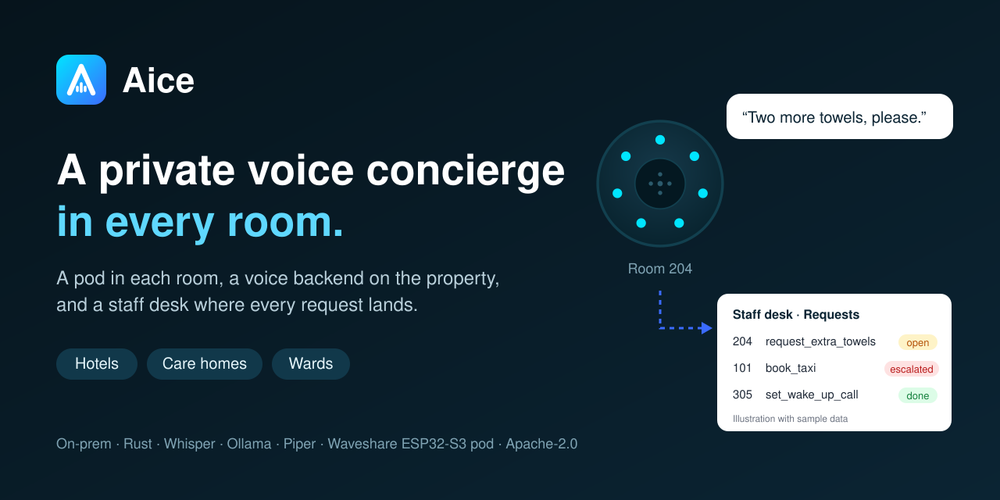
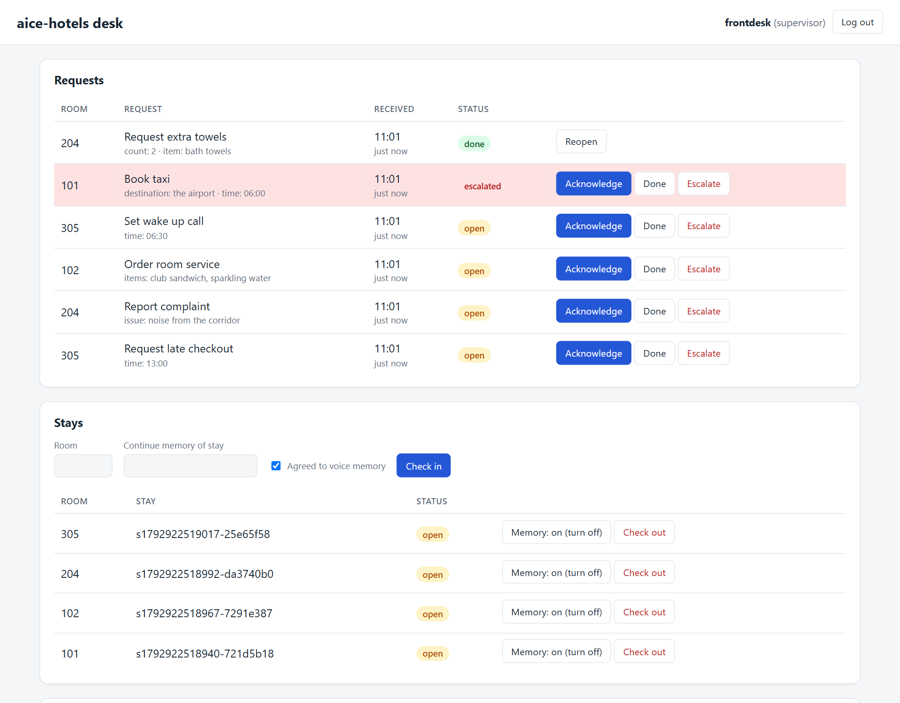
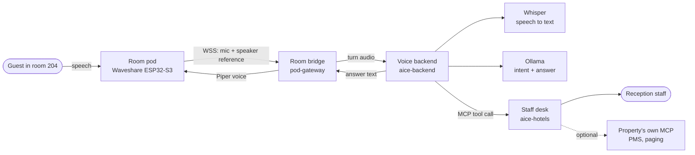

# Aice: a private voice concierge for every room

[](https://github.com/AncientiCe/aice/actions/workflows/ci.yml) [](https://github.com/AncientiCe/aice/actions/workflows/release-build-check.yml) [](https://github.com/AncientiCe/aice/releases) [](LICENSE)   



Aice puts a small voice pod in every room and a staff desk at reception. Guests ask for towels, a taxi or a late checkout in plain speech. The request lands on the desk as a ticket, and the pod confirms it was passed on. Guests can also ask everyday questions (weather, time, news, a recipe). Everything runs on one machine at the property: no cloud account, no audio leaving the building.

**Hotels come first.** The same system serves care homes and hospital wards through separate packs with stricter defaults.

| | |
|---|---|
| **In the room** | A [Waveshare ESP32-S3-AUDIO-Board](docs/deployment/pod.md) pod: two mics, a speaker, a ring of seven lights and three buttons. Guests can talk over an answer to stop it or correct it. |
| **At the desk** | A web [staff desk](docs/staff-desk.md) with requests, stays (check-in/out and memory consent), room devices and an audit log. Unhandled requests escalate on their own. |
| **On the property** | One host runs the voice backend (Whisper → Ollama), the room bridge (speech detection, echo cancellation, Piper voice) and the desk. |



<sub>The real `aice-hotels` desk, run locally with sample requests. It also has a [dark theme](docs/assets/screenshots/staff-desk-dark.png) and a [full-page view with the audit log](docs/assets/screenshots/staff-desk-full.png).</sub>

## How it works



1. **The guest speaks.** The pod streams its microphone, plus what its own speaker is playing, to the room bridge over TLS.
2. **The bridge finds the request.** It decides by audio energy where speech starts and ends, removes the pod's own voice from the mic, and sends the utterance to the backend as one turn.
3. **The backend understands it.** Whisper transcribes it. The LLM decides whether this is a room request (towels, taxi, wake-up call…), a question for a skill (weather, time, news…), or conversation. No keyword rules: the LLM makes every routing decision.
4. **Room requests become tickets.** The backend calls the desk's MCP tool. The room comes from the pod's device token, not from anything the guest said. Staff are paged, and a request nobody acknowledges escalates to the next tier.
5. **The pod answers.** The bridge turns the answer into speech with Piper and plays it on the pod. If the guest talks over it, the answer stops and what they said becomes the next turn. The model still knows what it was saying.

More: [How it works](docs/how-it-works.md) (guest journey, interruptions, privacy, help button) · [Software architecture](docs/software-architecture.md) (processes, crates, protocols, data, metrics).

## Status

Release [v0.4.0](https://github.com/AncientiCe/aice/releases/tag/v0.4.0) is ready for a **hotel dry run and pilot**.

**Tested on the Waveshare pod and a property host:** pod enrolment and room assignment from the desk, TLS between pod, bridge, backend and desk, spoken questions and answers, hotel requests landing on the desk, and talking over an answer mid-sentence. On that board the bridge removes 11–14 dB of echo. Over 27 s of answers the pod never interrupted itself. It stopped for normal speech within a second about 60% of the time. The button always stops an answer.

**Not tested on hardware yet:** signed firmware updates, lost-token recovery and factory reset. Capacity is gated in CI with simulated rooms. Run [`room-loadtest`](docs/architecture/README.md#30-capacity-measurement-room-loadtest) on the real host before go-live.

**Before care homes and wards:** a signed [DPIA](docs/compliance/dpia-template.md), and for wards a [clinical safety case](docs/compliance/clinical-safety-case.md) approved by a Clinical Safety Officer. Both are templates today. The databases are plain SQLite, so run them on an encrypted volume.

Room settings (temperature, lights, curtains, TV, music) are sent to staff as requests. The pod does not switch anything itself.

## One product, three packs

Each property runs one pack: the desk, its MCP tools and its defaults.

| Pack | For | Requests | Defaults |
|------|-----|----------|----------|
| `aice-hotels` | Hotels, serviced apartments | 27 tools: housekeeping, towels, pillows, room service, wake-up call, taxi, restaurant and spa bookings, late checkout, complaints, maintenance, lost items, room settings… | Memory consent at booking, kept after checkout; SLA 15 min |
| `aice-care` | Care homes | Bathroom help, a drink, pain, a visitor, lights, distress, a fall | Distress and falls always escalate; SLA 1 min for falls; consent ticked by staff |
| `aice-ward` | Hospital wards | Non-clinical only (`get_a_nurse` and similar); anything else is denied and escalated | Memory wiped at discharge; consent off by default |

Pack details: [aice-hotels](docs/skills/aice-hotels.md) · [aice-care](docs/skills/aice-care.md) · [aice-ward](docs/skills/aice-ward.md) · [what guests can say](docs/deployment/pod-voice-guide.md).

## Privacy and security

- **On-prem.** Speech-to-text, the LLM and the voice all run on the property host.
- **Memory only with consent, only for that stay.** A room without an open, consented stay remembers nothing. At checkout, memory is kept, archived for N days, or wiped, as the property chooses.
- **Locked down by default.** Staff log in with roles and CSRF protection, and five wrong passwords lock the account. Pods hold a device token issued by the desk. The backend uses a service token. All traffic uses TLS from a property-local CA. Every ticket, login, device and stay change is written to an append-only audit log.
- **Privacy mute and help button.** A double tap mutes the pod (magenta ring). A long press calls staff without speaking, even if speech recognition is down.

Details: [How it works: privacy](docs/how-it-works.md#privacy) · [Security policy](SECURITY.md).

## Install

Download a release archive for **Linux x86_64 or aarch64** from [Releases](https://github.com/AncientiCe/aice/releases). Each archive contains `aice-backend`, `pod-gateway`, `aice-hotels`, `aice-care`, `aice-ward` and `room-loadtest`.

```bash
shasum -a 256 -c aice-v0.4.0-linux-x86_64.tar.gz.sha256
tar -xzf aice-v0.4.0-linux-x86_64.tar.gz
./aice-hotels property.json
```

Then follow the [property pilot runbook](docs/runbooks/property-pilot.md): host, certificates, staff accounts, backend and bridge config, pods, alerts, capacity check, go-live checklist. Pods: [build, flash and provision](docs/deployment/pod.md).

## Develop

You need Rust, [Ollama](https://ollama.com), `whisper-cli` with a Whisper model, and Piper for the pod voice. The [developer setup](docs/setup/local-dev.md) runs the whole stack (desk, backend, bridge) on one machine.

```bash
cargo aice-fmt && cargo aice-clippy && cargo aice-audit && cargo aice-test   # quality gates
cargo run -p aice-hotels -- property.json                                      # staff desk on :8791
cargo aice-backend                                                             # voice backend on :8781
cargo aice-gateway                                                             # room bridge for pods on :8765
```

Contributions follow [AGENTS.md](AGENTS.md) (test first, no mocks, metrics on every path, no keyword routing of speech) and [CONTRIBUTING.md](CONTRIBUTING.md).

## Documentation

| | |
|---|---|
| [How it works](docs/how-it-works.md) | Guest journey, interruptions, memory, help button, alerts |
| [Software architecture](docs/software-architecture.md) | Processes, ports, crates, protocols, data stores, observability |
| [Staff desk](docs/staff-desk.md) | The back office: requests, stays, room devices, audit log, roles, alerts |
| [Room pod](docs/deployment/pod.md) · [Signal Pod requirements](docs/hardware/signal-pod.md) | Hardware, flashing, provisioning, updates, barge-in measurements |
| [Property pilot runbook](docs/runbooks/property-pilot.md) | Installing and running a pilot, training, rollback |
| [Architecture reference](docs/architecture/README.md) | Every flow with diagrams, inputs, failure paths and metrics |
| [Observability](docs/runbooks/local-observability.md) | Prometheus and Grafana, including the Guest Journey dashboard |
| [Skills](docs/skills/README.md) | Skills the voice backend can call (from [aice-skills](https://github.com/AncientiCe/aice-skills)) |
| [Changelog](CHANGELOG.md) | Release history |

## License

Apache-2.0. See [LICENSE](LICENSE).
