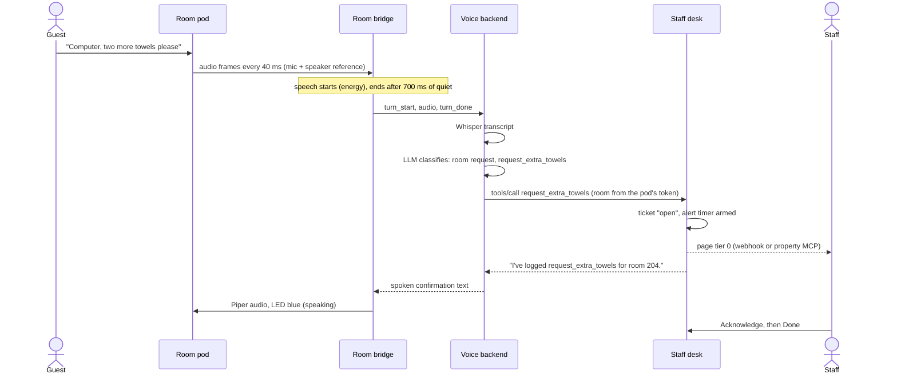
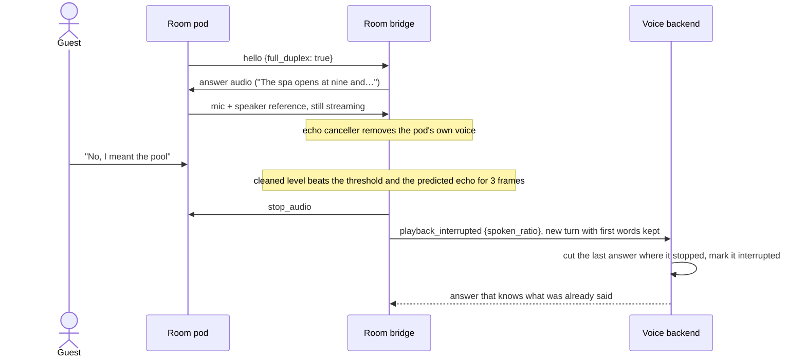
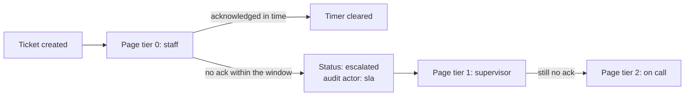
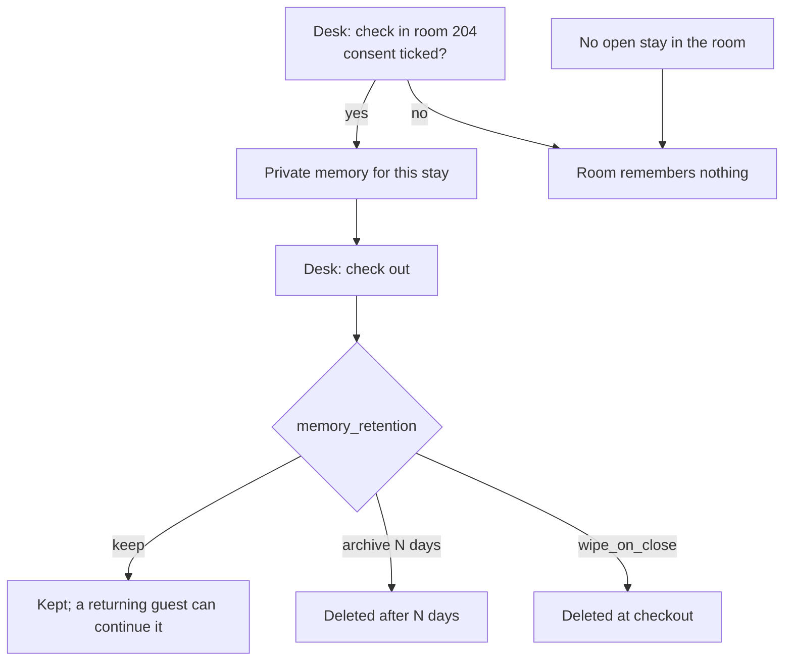

# How Aice works

What happens from the moment a guest speaks to the moment staff close the request. For the components and code behind each step, see [Software architecture](software-architecture.md). For every flow's inputs, failure paths and metrics, see the [architecture reference](architecture/README.md).

## The pieces

| Piece | Where | What it does |
|-------|-------|--------------|
| **Room pod** | One per room | Waveshare ESP32-S3-AUDIO-Board. Streams its microphone and its own speaker signal, plays answers, shows state on a 7-LED ring, and has three buttons. |
| **Room bridge** (`pod-gateway`) | Property host | One connection per pod. Finds where speech starts and ends, removes the pod's echo, sends turns to the backend and speaks answers with Piper. |
| **Voice backend** (`aice-backend`) | Property host | Whisper speech-to-text, LLM routing and answers through Ollama, skills, stay-scoped memory, admission control. |
| **Staff desk** (`aice-hotels`, `aice-care` or `aice-ward`) | Property host | The property's MCP server and web desk: tickets, stays, pods, staff accounts, alerts, audit log. |

## A guest request, start to finish

1. **Wake.** The guest says the wake word ("Computer"). The conversation stays awake while it is in flight and for 8 s after each answer, so follow-ups need no wake word ([architecture 31](architecture/README.md#31-wake-word-conversation-window)).
2. **Turn detection.** The bridge opens a turn after three loud frames and keeps the eight frames before it, so the first word is never cut. It closes the turn after 700 ms of quiet, or after 15 s. This is audio energy only: the bridge never looks at the words.
3. **Understanding.** The backend transcribes the turn and asks the LLM what it is: a room request, a skill question or conversation. The list of room requests comes live from the desk's `tools/list`. If the property adds its own MCP tools, the LLM can choose those too ([architecture 23](architecture/README.md#23-property-facilitator-hotels-care-ward)).
4. **Ticket.** A room request becomes a desk ticket for the room in the pod's device token. If the property has delegated that tool to its own system (PMS, paging), the desk calls that system once as well. The ticket still appears on the desk.
5. **Answer.** The pod confirms the request was passed on. If a skill fails (a provider times out, a place is unknown), the pod says it could not get the information instead of going silent. Chat replies are told they cannot act, so the pod never promises something that was not sent.

## Talking over an answer

Guests do not wait for the pod to finish. Any speech interrupts. There is no stop word.

- **Echo cancellation runs in the bridge.** A cross-correlation search finds how far the echo lags the speaker signal. A 256-tap NLMS filter then removes the rest. The pod's speaker reference is sample-aligned with its mic, so this runs on the host and is tested in CI ([architecture 32](architecture/README.md#32-spoken-barge-in-full-duplex-pods)).
- **Measured on the Waveshare pod:** 11–14 dB of echo removed. No self-interruption over 27 s of answers. Normal speech was caught within a second about 60% of the time, below the 95% target in the [Signal Pod criteria](hardware/signal-pod.md). The board's small speaker distorts, which limits linear cancellation. Guests may need to speak up slightly, and a button tap always stops an answer.
- **Pauses are not interruptions.** If the guest pauses ("Computer, … how do I make tahini") and goes on before any answer has started, the bridge sends both parts again as one request.
- **Short-term context.** The backend keeps the last few exchanges per room in memory only (never on disk). It clears them on a new stay or after 10 idle minutes, so "no, the other one" works.

## Buttons and lights

| Action | Result |
|--------|--------|
| Tap | Stops the answer and cancels an open turn |
| Double tap | Privacy mute: the pod stops sending audio (magenta ring). Double tap again to resume |
| Hold 1.5 s | Calls staff without speech: an escalated `help_button` ticket, then "I've called the staff. Someone is on the way." |
| Hold 5 s while powering on | Factory reset (forgets nonce and token) |

**Ring:** dim white booting · blue blink connecting · slow amber blink waiting for a room · green listening · amber thinking · blue speaking · magenta muted · fast red blink error.

The help button is a hardware signal, not speech, so it works when Whisper or the LLM is down. If the desk cannot be reached, the pod tells the guest to use the phone or call button ([architecture 29](architecture/README.md#29-help-button-degraded-mode)).

## Staff side: alerts and escalation

- Each property chooses its channels in `property.json`: a webhook (with an optional bearer token) or a tool on the property's own MCP (nurse call, DECT, PMS paging).
- Default acknowledgement windows: hotels 15 min for every request; care homes 1 min for falls and distress, 3 min for bathroom help and pain, 10 min otherwise; wards 2 min for `get_a_nurse`, 15 min otherwise.
- Timers are stored on the ticket, so a restarted desk picks them up again. With no channels configured, escalations still show on the desk, which refreshes every 10 s ([architecture 27](architecture/README.md#27-staff-alerting-and-sla-re-escalation)).
- A pod that goes silent for 2 minutes opens an escalated `device_offline` ticket for its room. When the pod comes back, the desk records it ([architecture 25](architecture/README.md#25-room-pod-provisioning-and-device-tokens)).

## Privacy

- **Per-stay memory, only with consent.** Each stay gets its own memory. The next guest in the room never hears the last guest's. Hotels default to consent (booking terms). Care homes and wards default to no consent, and staff tick it at check-in. Staff can switch it during a stay, and the change is audited ([architecture 26](architecture/README.md#26-stays-and-stay-scoped-memory)).
- **The room comes from the desk.** A supervisor assigns each pod its room. Pods present a desk-issued device token, which the backend checks on every connection and turn. A revoked pod is cut off at once ([architecture 25](architecture/README.md#25-room-pod-provisioning-and-device-tokens)).
- **Nothing in the clear.** Pods, bridge, backend and desk talk over TLS from a property-local CA. The desk refuses plain HTTP off loopback ([architecture 24](architecture/README.md#24-property-security-desk-login-service-token-tls)).
- **Encryption at rest is the host's job.** The ticket and memory databases are local SQLite files. Run them on an encrypted volume (LUKS or BitLocker).
- **No manual speech interpretation.** No keyword lists or regex routers: the LLM makes every routing decision. The bridge uses audio energy only.

## Care homes and wards

The flow is the same. The defaults are stricter:

- **Care homes (`aice-care`):** distress and falls always escalate and page within a minute. Consent defaults to off.
- **Wards (`aice-ward`):** only non-clinical tools exist (`wayfinding`, `appointment_time`, `request_porter`, `request_wheelchair`, `meal_logistics`, `get_a_nurse`). The policy engine denies anything else and escalates it to staff. Memory is wiped at discharge.

Go-live order is hotels, then care homes once a [DPIA](compliance/dpia-template.md) is signed, then wards once a [clinical safety case](compliance/clinical-safety-case.md) is approved ([pilot runbook](runbooks/property-pilot.md)).
