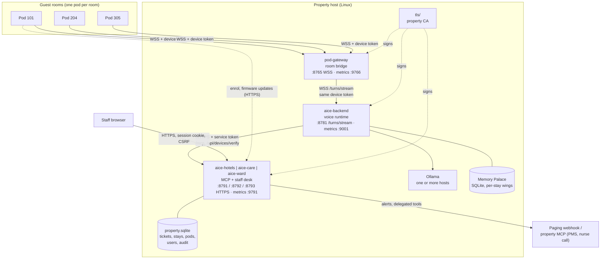
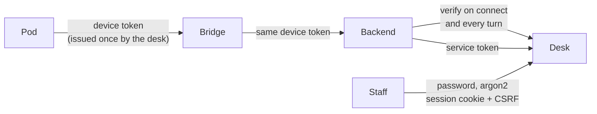
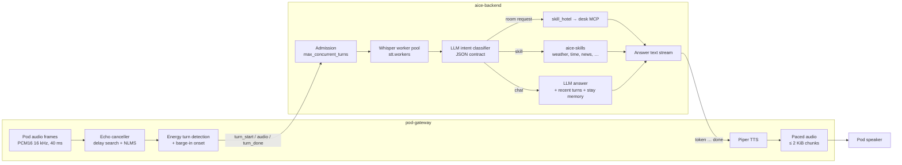
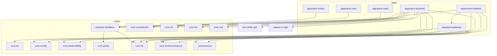
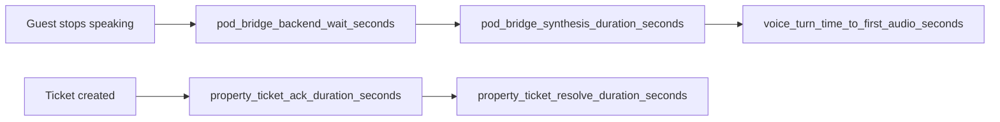

# Software architecture

How the property system is built: the processes on the host, how they talk, what each crate owns, where data lives and how it is observed. For the guest-facing flow, read [How it works](how-it-works.md) first. Each flow has a numbered section in the [architecture reference](architecture/README.md) with its inputs, failure paths and metrics.

## Deployment view

One property host runs three long-lived processes, plus Ollama. Pods and staff browsers reach it over the property LAN.

| Process | Binary | Default bind | Role |
|---------|--------|--------------|------|
| Room bridge | `pod-gateway` (`cargo aice-gateway`) | `pod_bind` `0.0.0.0:8765`; metrics `127.0.0.1:9766` | One WebSocket per pod. Turn detection, echo cancellation, barge-in, Piper speech, pacing audio for the pod's small playback queue |
| Voice backend | `aice-backend` (`cargo aice-backend`) | `0.0.0.0:8781` (`AICE_BACKEND_BIND`): `/turns/stream`, `/healthz`, `/metrics`; metrics `127.0.0.1:9001` | Whisper STT, LLM classification and answers, skills, stay-scoped memory, admission control, LLM host failover, retention purge job |
| Staff desk and MCP | `aice-hotels` / `aice-care` / `aice-ward` | `127.0.0.1:8791` / `8792` / `8793` without a `bind` in `property.json`; metrics from `metrics_bind` | MCP server (`/mcp`) for the backend, web desk (`/desk`), device enrolment and verification, stays, alerts, firmware manifest, audit log |
| Capacity tool | `room-loadtest` (`cargo aice-loadtest`) | client only | Enrols simulated pods and drives N rooms end to end; reports p50/p95/max time to first answer audio |

## Trust boundaries

- **Pods** enrol with a secret nonce. A supervisor assigns the room on the desk, and the pod then receives its device token once. The backend asks the desk to verify the token on connect and again at every `turn_start`. The answer carries `device_id`, `room` and `memory_wing` (the current consented stay), which override anything the client sends ([architecture 25](architecture/README.md#25-room-pod-provisioning-and-device-tokens)).
- **The backend** reaches the desk with a random service token written beside `property.json` on first start. That token unlocks `/mcp`, device verification, stay purge and read-only ticket listing. It cannot change tickets.
- **Staff** log in as `staff` or `supervisor`. Sessions last 12 h. Five failed passwords lock the account for 5 min. Audit rows cannot be updated or deleted: SQLite triggers reject it ([architecture 24](architecture/README.md#24-property-security-desk-login-service-token-tls)).
- **TLS everywhere off loopback.** `tls.mode: auto` creates a property CA under `tls/` and signs the desk certificate. `tls issue` signs the backend and bridge certificates. Pods get the CA and the firmware signing key compiled into `property_trust.h`.

## Inside a turn

- **Routing is LLM-only.** The classifier returns a JSON intent. For room requests the `hik` enum comes from the desk's live `tools/list`, including the property's own MCP tools. No transcript keyword matching is allowed anywhere (rules 10 and 10.1 in [AGENTS.md](../AGENTS.md)).
- **Capacity controls.** Turns and STT jobs take a permit and queue in arrival order. A turn that cannot start within `service.turn_queue_max_wait_ms` gets a spoken "helping other rooms" reply instead of silence. LLM calls rotate across `ollama_url` and `ollama_urls`, and a failing host is skipped for 30 s ([architecture 28](architecture/README.md#28-capacity-admission-control-worker-pools-and-llm-failover)).
- **Speed fixes that matter on CPU.** Whisper encodes only the clip plus a margin, not a full 30 s window. Every call to a shared Ollama host uses one context size, so the warm model is never reloaded mid-turn.

## Protocols

| Link | Transport | Messages |
|------|-----------|----------|
| Pod → bridge | WSS JSON, `Authorization: Bearer <device token>` | `hello {device_id, full_duplex}`, `audio {payload, reference}`, `tap_activate`, `help_button`, `ping`. Back: `hello_ack`, `led`, `audio`, `stop_audio`, `pong`, `error`. Types in `crates/pod-protocol` |
| Bridge → backend | WSS JSON `/turns/stream` | `turn_start`, audio frames, `turn_done`, `turn_cancel`, `playback_started`, `playback_finished`, `playback_interrupted {spoken_ratio}`, `help_request`. Back: tokens, `done`, `help_raised`. Types in `crates/core-runtime-protocol` |
| Backend → desk | HTTPS JSON-RPC (MCP) `/mcp`, plus REST | `tools/list`, `tools/call`; `POST /api/devices/verify`, `/api/devices/heartbeat`, `/api/devices/help`, `GET /api/stays/purge-due` |
| Pod → desk | HTTPS REST | `POST /api/devices/enroll`, `GET /api/firmware/manifest`, `GET /api/firmware/<version>.bin` (ECDSA P-256 signed images, staged rollout) |
| Desk → property | Webhook JSON or MCP `tools/call` | Alerts per tier; delegated tools called once on the property's own MCP |

## Code map

| Path | Owns |
|------|------|
| `apps/aice-backend` | Voice runtime service: `/turns/stream`, wake-word window, conversation log, retention job, device-token checks |
| `apps/pod-gateway` | Room bridge: `bridge.rs` (turns, playback, barge-in), `echo.rs` (echo canceller) |
| `apps/aice-hotels`, `aice-care`, `aice-ward` | Thin binaries that pick a pack and run `property-facilitator` |
| `apps/room-loadtest` | Simulated pods for capacity runs and the CI capacity gate |
| `crates/property-facilitator` | MCP server, desk HTML, auth, stays, devices, alerts, firmware, SQLite store, CLI |
| `crates/core-orchestrator` | Conversation engine, intent classification, routing, cancellation |
| `crates/core-stt`, `core-llm`, `core-tts`, `core-vad` | Whisper adapter and worker pool, Ollama streaming with failover, Piper synthesis, voice activity detection |
| `crates/core-policy` | Ward tool allow-list and autonomy policy |
| `crates/core-tls` | Property CA, certificate issue, rustls helpers |
| `crates/core-config` | Typed `config.json` with defaults |
| `crates/core-observability` | JSON logs, Prometheus exporter, turn traces (`slow_turn`) |
| `crates/core-runtime-protocol`, `pod-protocol` | Wire types for bridge ⇄ backend and pod ⇄ bridge |
| `pod-firmware` | ESP32-S3 Arduino firmware (`waveshare_audio` PlatformIO env): codecs, full-duplex I²S, LEDs, buttons, enrolment, signed updates |
| [`aice-skills`](https://github.com/AncientiCe/aice-skills) | Skill crates (weather, time, distance, news, sports, holidays, fuel, horoscope, smart home), pinned git dependency |
| [`palace-rs`](https://github.com/AncientiCe/palace-rs) | Memory Palace: SQLite store, BM25 and embedding recall, knowledge graph, per-wing purge |

## Data

| Store | Owner | Contents | Lifetime |
|-------|-------|----------|----------|
| `property.sqlite` | Desk | Tickets and alert timers, stays and consent, pods and token hashes, staff users, sessions, append-only `audit_events` | Property-managed; back up with the host |
| Memory Palace (SQLite) | Backend | One wing per consented stay (`stay-<id>`): drawers, embeddings, knowledge-graph facts | `keep`, `archive` after N days, or `wipe_on_close`; purged by the backend retention job every 60 s |
| Conversation log | Backend | Last `memory.max_recent_turns` exchanges per session | RAM only; cleared on a new stay or after 10 idle minutes |
| `service.token`, `tls/` | Desk | Backend credential, property CA and certificates | Created on first start; keep on the encrypted volume |
| `property_trust.h` | Firmware build | Property CA, firmware public key, desk URL | Git-ignored; regenerated per property |

## Observability

Every path is metered (rule 6 in [AGENTS.md](../AGENTS.md)). Each process exposes Prometheus metrics. `./scripts/observability.sh up` starts Prometheus on `:9090` and Grafana on `:3000` with these dashboards: **Aice Guest Journey**, Aice Backend Latency, Aice Backend Dependency Latency, Aice Backend Service Overview, and Aice Backend Skills ([runbook](runbooks/local-observability.md)).

- **Slow turns explain themselves.** A turn whose wait after speech reaches `service.slow_turn_threshold_ms` (default 3 s) logs one `slow_turn` line. That line holds the full stage timeline (STT, classify, memory, skill, LLM), the slowest stage and any unaccounted time ([architecture 33](architecture/README.md#33-guest-journey-timing-and-slow-turn-tracing)).
- **Fleet health:** `fleet_devices{status}`, `fleet_heartbeat_missed_total`. **Requests:** `property_requests_total{pack,tool,status}`, `property_sla_breaches_total`. **Interruptions:** `pod_bridge_barge_in_total{result}`, `pod_bridge_barge_in_latency_seconds`.

## Quality gates

CI runs `cargo aice-fmt`, `cargo aice-clippy` (`unwrap` and `expect` denied), `cargo aice-audit` and `cargo aice-test` on every push. It also builds the pod firmware. The test suite starts each pack binary and checks a live ticket. It also runs 8 rooms × 2 turns through the real bridge, backend and desk, with explicit test doubles for STT, LLM and speech. Every turn must be answered, and p95 must stay under 5 s. Release archives (including Linux x86_64 and aarch64) are built by `.github/workflows/release.yml`.
