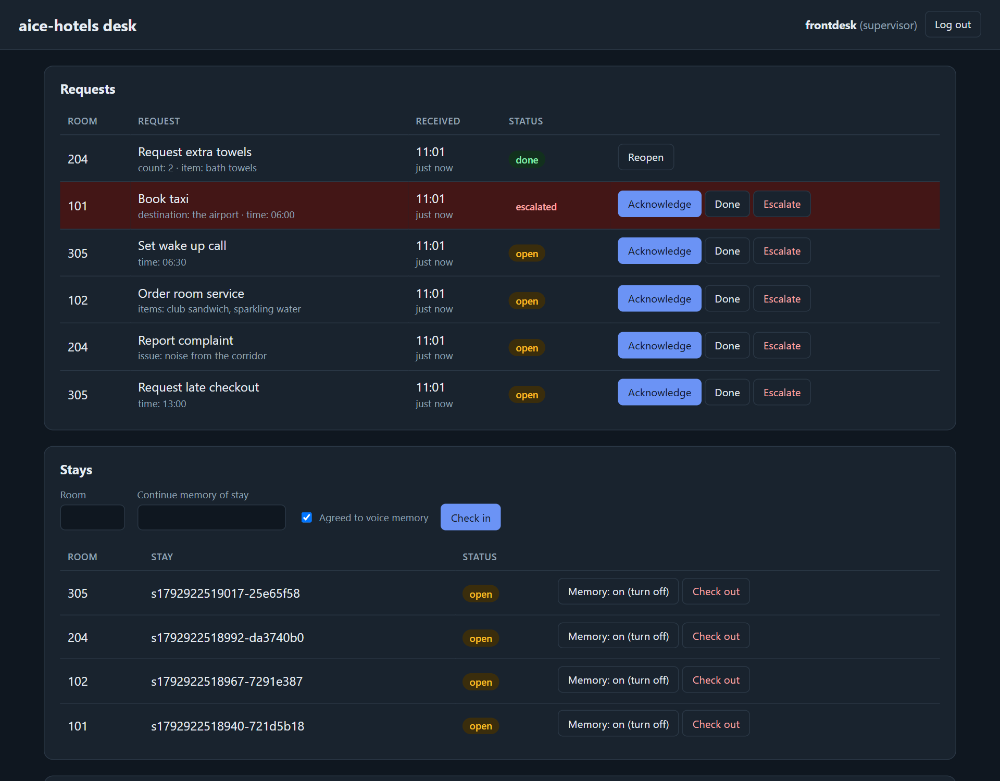
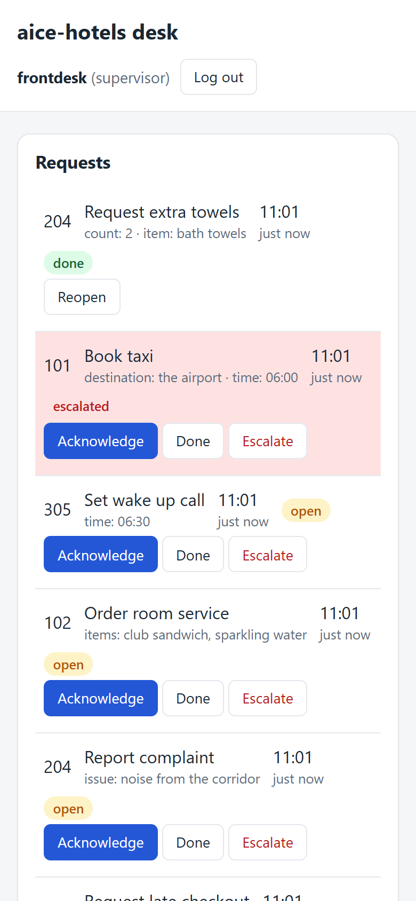
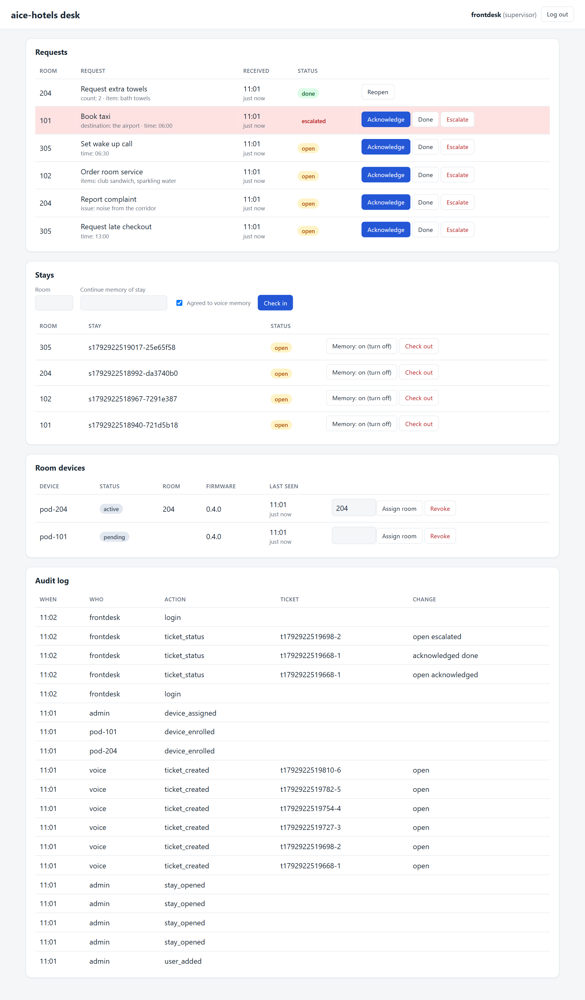
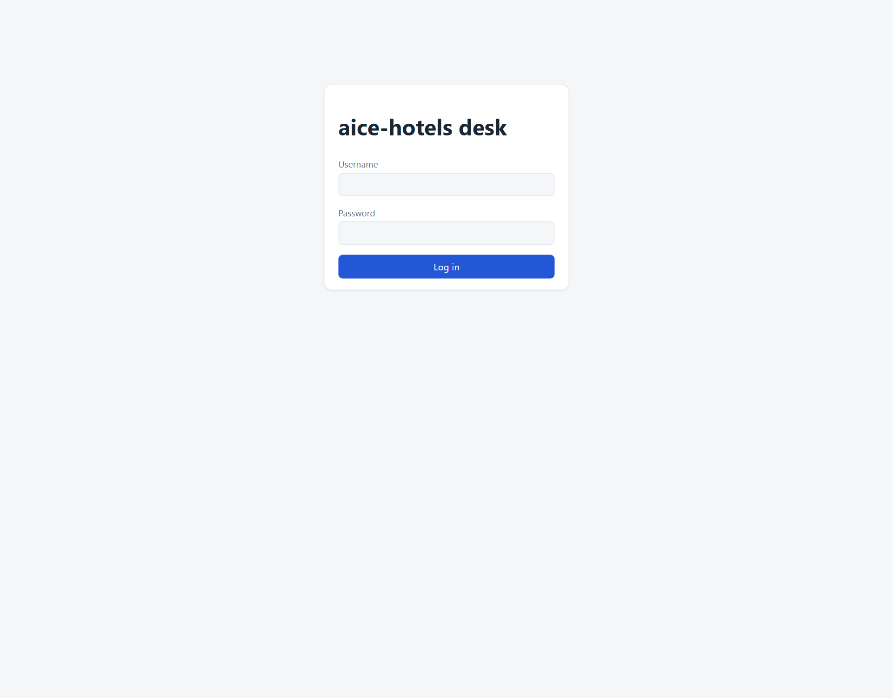

# Staff desk (back office)

The staff desk is where every room request lands. It is served by the property's pack (`aice-hotels`, `aice-care` or `aice-ward`) at `https://<desk host>:<port>/desk`. It is a plain server-rendered page, so it works in any browser at reception, in the back office or on a duty tablet. It refreshes every 10 s and follows the device's light or dark theme.

The screenshots below are the real `aice-hotels` desk, run locally with sample requests.


<details>
<summary>Dark theme</summary>



</details>

<details>
<summary>On a phone: each request becomes a card with its buttons underneath</summary>



</details>

<details>
<summary>Full page, including room devices and the audit log (supervisor view)</summary>



</details>

## Logging in



Staff accounts are created on the host. Nobody signs up from the browser:

```bash
aice-hotels property.json user add duty.manager supervisor
aice-hotels property.json user add anna staff
aice-hotels property.json user list
aice-hotels property.json user remove anna
```

Passwords are prompted twice, or read from `AICE_PROPERTY_PASSWORD` for scripted installs. They need 12+ characters and are stored with argon2. Five wrong passwords lock the account for five minutes. Sessions last 12 hours in an `HttpOnly; SameSite=Strict` cookie, and every form carries a CSRF token.

## Roles

| | Staff | Supervisor |
|---|:---:|:---:|
| See requests; Acknowledge, Done, Escalate | ✓ | ✓ |
| Check guests in and out; switch memory consent | ✓ | ✓ |
| Reopen a finished request | | ✓ |
| Room devices: assign a pod to a room, revoke a pod | | ✓ |
| Audit log (latest 50 events) | | ✓ |

## Requests

Each spoken room request, help-button press or offline pod becomes one row:

- **Room**, taken from the pod's device token or a mapped phone extension.
- **Request**: what was asked ("Book taxi"), with the guest's details underneath ("destination: the airport · time: 06:00").
- **Received**: the time in the property host's local zone, and how long ago.
- **Status**, then the buttons.

| Status | Meaning | Badge |
|--------|---------|-------|
| `open` | New. Staff have been paged | amber |
| `acknowledged` | Someone took it. The escalation timer stops | blue |
| `done` | Finished. Supervisors can reopen it | green |
| `escalated` | Not acknowledged in time, raised by staff, a care-home fall or distress call, a denied ward request, a help button or an offline pod. The row turns red | red |

- **Escalation is automatic.** If nobody acknowledges a request within its window, the desk marks it `escalated` (audit actor `sla`) and pages the next tier: staff, then supervisor, then on call. See [How it works: alerts](how-it-works.md#staff-side-alerts-and-escalation).
- **`device_offline`** means a pod has been silent for 2 minutes, so that room cannot call by voice. Check its power and Wi-Fi.
- **`help_button`** means a guest held a button to call staff without speaking. Treat it as urgent.
- Integrations can read the request list with the service token (`GET /api/tickets`). They cannot change tickets.

## Stays

Check-in opens a stay for a room. The stay decides whether the pod in that room remembers anything.

- **Check in:** enter the room and tick **Agreed to voice memory** only if the guest agreed. Hotels tick it by default (booking terms). Care homes and wards leave it unticked.
- **Returning guest:** put their earlier stay id in **Continue memory of stay**. This works only while that memory still exists.
- **Memory: on / off:** switches consent for an open stay. The change is audited.
- **Check out:** closes the stay. `memory_retention` in `property.json` then keeps the memory, archives it for N days or wipes it.

A room with no open, consented stay remembers nothing. The same actions exist on the CLI: `stay open <room> [--consent|--no-consent] [<continue-from>]`, `stay close <id>`, `stay list`.

## Room devices (supervisors)

Every pod that has enrolled appears here with its status, room, firmware version and last contact.

| Status | Meaning | What to do |
|--------|---------|------------|
| `pending` | A new pod is waiting for a room (slow amber blink) | Type the room and press **Assign room**. The pod turns green within 10 s |
| `active` | Assigned and trusted | Assign a new room to move it |
| `OFFLINE` | No heartbeat for 2 minutes; a `device_offline` request is open | Check power and Wi-Fi. It clears on the next sign of life |
| `revoked` | Retired. The pod is refused at once | Re-enrol after a factory reset |

CLI equivalents: `device list`, `device assign <id> <room>`, `device revoke <id>`. Building and flashing pods: [room pod guide](deployment/pod.md).

## Audit log (supervisors)

An append-only record of who did what and when: logins, logouts and lockouts, user changes, ticket creation and every status change, pod enrolment, assignment, revocation and token rotation, stay check-in and check-out, consent changes, and SLA breaches. SQLite triggers reject updates and deletes, so the log cannot be edited after the fact.

## Alerts and paging

Configure alerts in `property.json`. Without channels, escalations still show on the desk. A pilot should have at least a first-tier channel (the duty phone) and a second tier (the duty manager):

```json
"alerts": {
  "tiers": ["staff", "supervisor", "on_call"],
  "channels": [
    { "name": "duty-phone", "kind": "webhook", "url": "https://pager.hotel.local/hook", "token_file": "pager.token", "tiers": ["staff"] },
    { "name": "manager", "kind": "property_mcp", "tool": "page_duty_manager", "tiers": ["supervisor", "on_call"] }
  ],
  "rules": [
    { "tools": ["request_maintenance", "report_complaint"], "ack_within_secs": 300 },
    { "tools": ["*"], "ack_within_secs": 900 }
  ]
}
```

`rules` replace the pack's defaults, and the first matching rule wins, so end with a `"*"` rule. Default windows: hotels 900 s for every request; care homes 60 s for falls and distress, 180 s for bathroom help and pain, 600 s otherwise; wards 120 s for `get_a_nurse`, 900 s otherwise ([architecture 27](architecture/README.md#27-staff-alerting-and-sla-re-escalation)).

## Connecting the property's own systems

- **Phones:** `extensions` maps a phone extension to a room, so a request that arrives with an extension lands on the right room.
- **Delegated tools:** list tool names in `delegated_tools` and set `property_mcp_url`. The desk then calls the property's MCP once for those requests, for example to post to the PMS. The ticket still appears on the desk. If the property MCP is down, the ticket is escalated instead of lost.
- **Extra tools:** tools the property MCP lists are offered to the voice classifier as well ([aice-hotels](skills/aice-hotels.md)).

## Monitoring the desk

Each desk page render is counted in `property_desk_renders_total{pack,result}` and timed in `property_desk_render_duration_seconds{pack}`. The page reloads every 10 s per open browser, so a slow render shows up there first.
